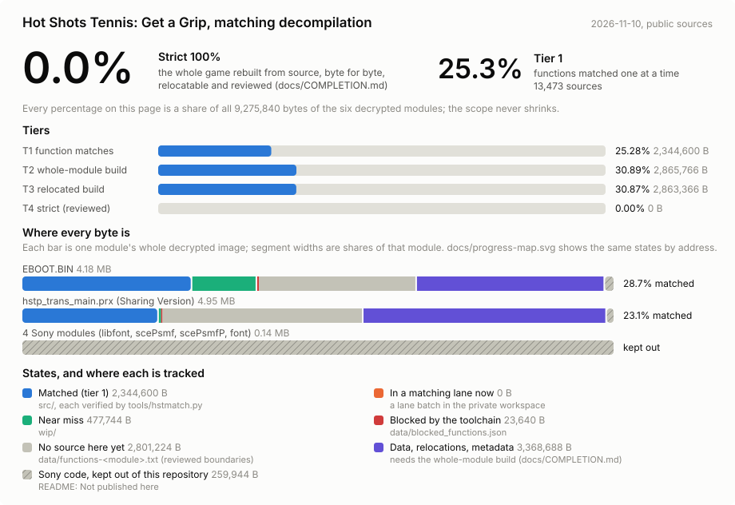
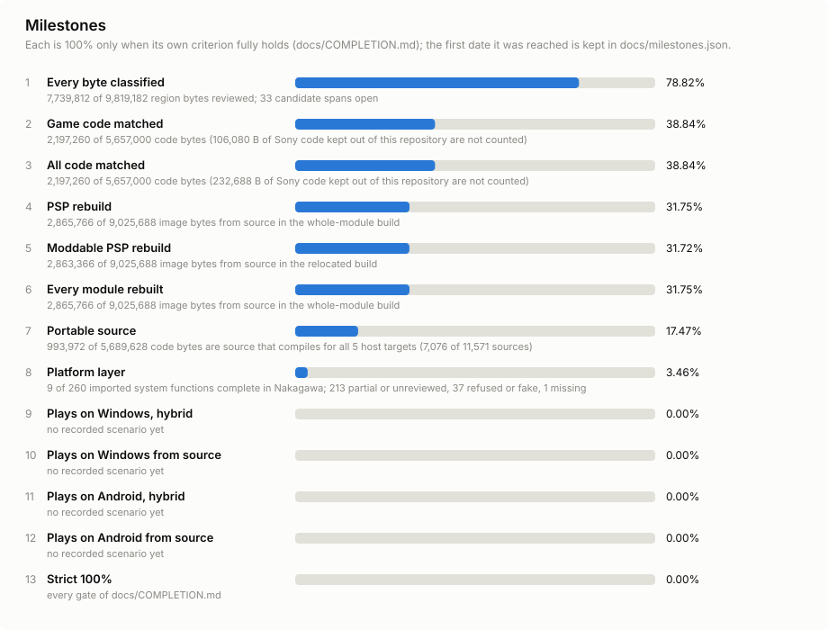
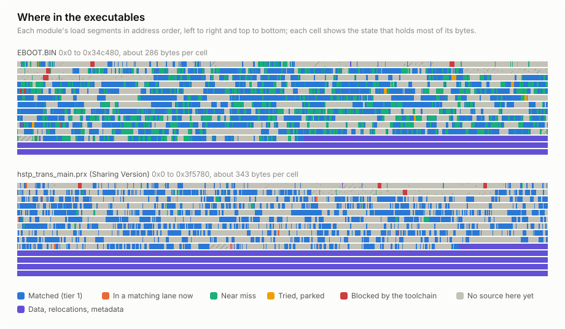
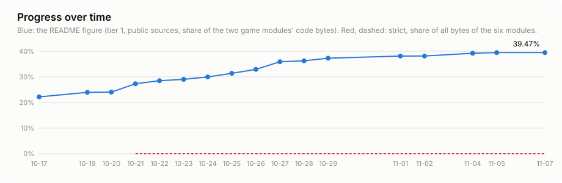

# Progress report

The [README](../README.md#progress-at-a-glance) gives the headline numbers. This page has the full picture. Every
figure here is generated by `python tools/hstprogress.py --write`; none is edited by hand.

## The figures

<!-- hstprogress:begin progress-figures -->

Measured 2026-11-02 from the public sources: 12,777 exact sources and 1,287 near misses.

| Figure | Matched | Of | Share |
|---|---|---|---|
| Code matched, both game modules | 2,198,032 B (12,780 functions) | 5,763,080 B (19,634 functions) | 38.140% |
| `EBOOT.BIN` code | 1,146,392 B (6,523 functions) | 2,849,076 B (9,804 functions) | 40.237% |
| `hstp_trans_main.prx` (Sharing Version) code | 1,051,640 B (6,257 functions) | 2,914,004 B (9,830 functions) | 36.089% |
| Tier 1: function matches | 2,198,032 B | the six modules in scope, 9,275,840 B | 23.696% |
| Tier 2: whole-module build | 2,865,766 B | the six modules in scope, 9,275,840 B | 30.895% |
| Tier 3: shifted build | 2,863,366 B | the six modules in scope, 9,275,840 B | 30.869% |
| Tier 4: strict (reviewed) | 0 B | the six modules in scope, 9,275,840 B | 0.000% |

<!-- hstprogress:end -->

## Why there are several percentages

Most figures below are the same matched code measured against a different total:

| Figure | Matched work | Divided by |
|---|---|---|
| Code matched (README headline) | code bytes of matched functions | the code of the two game modules' functions (`EBOOT.BIN` and the Sharing Version `hstp_trans_main.prx`) |
| Per-module code share | the same, one module at a time | that module's function code |
| Per-module "matched" in the chart below | the same | that module's whole file, data included |
| Tier 1 | the same | all six modules in scope (the two game modules plus four Sony libraries), 9,275,840 bytes |

The other tiers measure different work:

- **Tier 2, built from source:** bytes the whole-module build reproduces from source (code, data and relocations).
  This is the README's second headline number.
- **Tier 3, shifted build:** the same build loaded at a different address, showing it doesn't depend on fixed addresses.
- **Tier 4, strict:** the project's 100%: every byte rebuilt from source, relocatable, and reviewed by a person.

[`COMPLETION.md`](COMPLETION.md) defines each tier and its gates.

## Every byte of each module

## Milestones

## Where in the executables

## Over time

The daily figures are in [`progress.csv`](progress.csv). The milestone data is in [`milestones.json`](milestones.json).

## For trackers

[`objdiff-report.json`](objdiff-report.json) is the same figure in objdiff's report format. A daily workflow
publishes it as the `UCUS98701_report` artifact, which [bytematch.dev](https://bytematch.dev/Jstar269/hst-decomp) and
[recomp.fyi](https://recomp.fyi) read. Its units are the game's own source files where the program shows them
([`translation-units.json`](../data/translation-units.json): file names from the debug build's assertions, carried to
EBOOT.BIN through identical functions and filled in link order), the published sources for the other matched
functions, one "not yet recovered" unit for each remaining function, and one unit per module for the SDK library code,
which is counted but not published. So bytematch.dev draws a map of the whole code with a tile per function. Data is
listed as unmatched, so no tracker can show the game as complete early.

OpenSSF Scorecard ([`scorecards.yml`](../.github/workflows/scorecards.yml)) runs weekly and on pushes to `main`,
uploading its results to GitHub code scanning.
